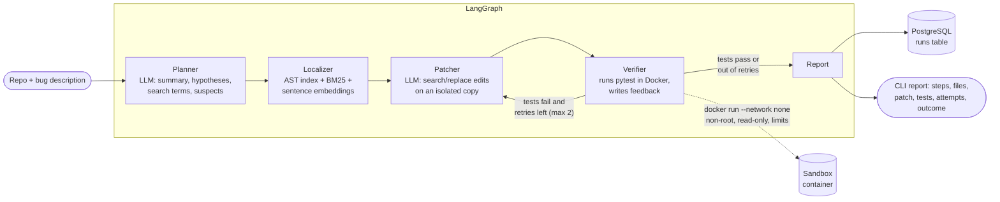

# Autonomous AI Software Engineering Agent

A multi-agent bug-fixing system. Give it a Python repo and a bug description; four
agents connected with **LangGraph** plan, find the relevant code (**Python AST** +
keyword search + **PyTorch sentence embeddings**), write a patch with an **LLM**
(Claude via the Anthropic API), and verify it by running the repo's tests in a
locked-down **Docker** sandbox, retrying with test feedback when a patch fails.
Every run is recorded in **PostgreSQL**.

> **Status:** the system, eval harness and SWE-bench adapter are built and tested
> (68 tests). **No real-model results have been measured yet**: running the eval
> needs an Anthropic API key, which hasn't been set up. See [Results](#results).

## Architecture



| Agent | File | What it does |
|---|---|---|
| Planner | [swe_agent/agents/planner.py](swe_agent/agents/planner.py) | Asks the LLM what to investigate (or uses issue keywords in "reduced" mode). |
| Localizer | [swe_agent/agents/localizer.py](swe_agent/agents/localizer.py) | Ranks functions/classes from the AST index ([code_index.py](swe_agent/code_index.py)) with hybrid retrieval ([retrieval.py](swe_agent/retrieval.py)). |
| Patcher | [swe_agent/agents/patcher.py](swe_agent/agents/patcher.py) | Asks the LLM for exact search/replace edits, applies them to a copy of the repo, produces a diff. Each retry starts from the original code and sees the previous diff + verifier feedback. |
| Verifier | [swe_agent/agents/verifier.py](swe_agent/agents/verifier.py) | Runs the tests ([test_runner.py](swe_agent/test_runner.py)) and turns failures into feedback. |

The graph is in [swe_agent/graph.py](swe_agent/graph.py); [swe_agent/pipeline.py](swe_agent/pipeline.py) runs it.

### Sandbox

Tests run in a throwaway container ([docker/sandbox.Dockerfile](docker/sandbox.Dockerfile)):
non-root user, `--network none`, read-only root filesystem and read-only repo mount,
small writable `/tmp`, 512 MB memory, 1 CPU, 256 processes, all Linux capabilities
dropped, `no-new-privileges`, no host environment variables (so no API keys), no
Docker socket, and a timeout that kills the container. These are checked by
[tests/test_sandbox.py](tests/test_sandbox.py), which runs inside the container.

### Retrieval (RAG without a vector DB)

1. `ast` indexes every function, method and class (file, lines, source, docstring).
2. BM25 keyword search over identifiers, docstrings and code.
3. Optional sentence embeddings (`sentence-transformers/all-MiniLM-L6-v2`, PyTorch on CPU),
   kept in a numpy array. Scores are combined; the top snippets go to the patcher.

## Setup

Requirements: Python 3.12, [uv](https://docs.astral.sh/uv/), Docker. Tested on an
Apple M3 MacBook Pro (8 GB RAM) with Docker Desktop.

```bash
git clone <this repo> && cd autonomous-swe-agent
uv sync --extra embeddings          # drop --extra embeddings for keyword-only retrieval
cp .env.example .env                # then put your ANTHROPIC_API_KEY in .env
docker compose up -d db             # PostgreSQL on localhost:5433
```

The sandbox image is built automatically on first use.

## Usage

```bash
# Fix a bug (needs ANTHROPIC_API_KEY in .env)
uv run python main.py --repo ./examples/buggy_app --issue "Login crashes when email is missing"

# No API key? Watch the real pipeline run with a SCRIPTED LLM (hand-written replies)
uv run python main.py --offline-demo

# Past runs from Postgres
uv run python main.py --history 10
```

The CLI prints the investigation steps, relevant files, the proposed patch, test
results, number of attempts and the final outcome. Useful flags: `--sandbox local`
(no Docker; not isolated), `--planning reduced`, `--no-embeddings`,
`--feedback minimal`, `--max-retries N`, `--no-db`.

**Offline demo output** (the planner/patcher replies are scripted; the first patch is
deliberately incomplete so the retry loop runs. Everything else is real):

```text
=== Investigation steps ===
  planner: login() raises when the email field is missing
  localizer: searched 12 symbols (keyword+embedding)
  localizer:   app/auth.py:32 login
  ...
  patcher: attempt 1: Use .get (still crashes on None).
  verifier: 6 passed, 2 failed, 0 errors in 0.54s -> FAIL
  patcher: attempt 2: Return an error when email is missing or empty.
  verifier: 8 passed, 0 failed, 0 errors in 0.29s -> PASS
  report: resolved after 2 patch attempt(s)
...
=== Outcome ===
  RESOLVED after 2 patch attempt(s) in 1.7s
```

## Evaluation

### Bug set ([eval/bugs](eval/bugs))

10 small, reproducible Python bugs (wrong discount math, pagination offset, shared
mutable default, temperature formula, word-count normalization, negative stock,
inclusive date range, quoted CSV commas, uncapped backoff, missing login email).
Each has a repo the agent sees (with a failing test), **hidden tests used only for
grading**, and a reference fix. [tests/test_eval_bugs.py](tests/test_eval_bugs.py)
checks every bug reproduces and its reference fix passes.

### Configurations ([eval/run_eval.py](eval/run_eval.py))

| Config | What changes |
|---|---|
| `multi_agent` | Full system |
| `baseline` | Single agent: one LLM call with whole files (BM25-ranked), one test run, no planner/localizer/retries ([baseline.py](swe_agent/baseline.py)) |
| `no_embeddings` | Retrieval ablation: keyword (BM25) only |
| `reduced_planning` | Planning ablation: no LLM planner, issue keywords only |
| `minimal_feedback` | Verifier ablation: retries get "tests still fail" only |
| `no_retries` | Self-correction ablation: one patch attempt |

Metrics: resolve rate (visible + hidden tests pass), mean/median time, attempts,
**validation accuracy** (how often the verifier's PASS/FAIL verdict matches the
hidden-test grade), verifier PASS precision, LLM calls, tokens and cost.

```bash
uv run python eval/run_eval.py --dry-run
uv run python eval/run_eval.py --bugs cart_discount     # small pilot
uv run python eval/run_eval.py                          # 10 bugs x 6 configs
```

### SWE-bench Verified (minimal adapter)

[swe_agent/swebench.py](swe_agent/swebench.py) loads the official
`princeton-nlp/SWE-bench_Verified` dataset and its fields (`problem_statement`,
`base_commit`, `patch`, `test_patch`, `FAIL_TO_PASS`, `PASS_TO_PASS`).

Limits (on purpose, to fit an 8 GB ARM Mac):

- Only `pytest-dev/pytest`, versions 5.4–7.2: 12 of the 500 instances are candidates.
- The official x86 images aren't used. Two small ARM environments are built from
  hand-written dependency specs ([docker/swebench.Dockerfile](docker/swebench.Dockerfile)).
- An instance counts as compatible only if its FAIL_TO_PASS tests fail before the gold
  patch and FAIL_TO_PASS + PASS_TO_PASS pass after it, in this environment:
  **11 of 12 are compatible** ([eval/swebench/compatible.json](eval/swebench/compatible.json)).
  `pytest-dev__pytest-7324` is excluded because its test ids can't be selected.
- Some dataset test ids are cut off at a space; those select the whole parametrized test.
- Setting: the agent's repo includes `test_patch` and its verifier runs FAIL_TO_PASS;
  grading uses the official criteria. **Results are not comparable to the official
  leaderboard.**

```bash
uv sync --extra embeddings --extra swebench
uv run python eval/swebench_validate.py        # no LLM; rebuilds compatible.json
uv run python eval/run_swebench.py --dry-run
uv run python eval/run_swebench.py             # multi_agent vs baseline on the subset
```

## Results

**No real-model results yet.** Running the eval and SWE-bench needs an Anthropic API
key, which hasn't been set up. Results will be written to `eval/results/<timestamp>/`
when the commands above are run.

What has been measured (Apple M3 MacBook Pro, 8 GB RAM, Docker 28.3.3, 2026-11-14), with no LLM:

| Check | Result |
|---|---|
| Unit + integration tests | 68 passed with all extras (66 passed, 2 skipped with core deps only, as in CI) |
| Eval bugs reproduce, and reference fixes pass visible + hidden tests | 10 / 10 |
| Harness with an oracle LLM (returns the reference fix) | multi_agent, baseline and no_retries resolve 2/2 sampled bugs; validation accuracy 100% |
| Harness with a no-op LLM | 0 resolved; multi_agent stops after 3 attempts |
| SWE-bench Verified pytest instances compatible with the ARM sandbox | 11 / 12 |
| SWE-bench harness with an oracle LLM on `pytest-dev__pytest-10051` | resolved (multi_agent and baseline) |
| Sandbox checks (non-root, no network, no host secrets, read-only, memory limit, timeout kill) | all pass |

Resume claims and their evidence are tracked in [docs/RESUME_MAPPING.md](docs/RESUME_MAPPING.md).

## Project layout

```text
main.py                 CLI
swe_agent/
  agents/               planner, localizer, patcher, verifier
  graph.py              LangGraph wiring + retry loop
  pipeline.py           run_agent(): workspace, graph, final report
  code_index.py         Python AST index
  retrieval.py          BM25 + sentence-embedding retrieval
  llm.py                Anthropic client, scripted fake for tests
  test_runner.py        local and Docker pytest runners
  db.py                 PostgreSQL storage
  baseline.py           single-agent baseline
  evaluation.py         bug set, grading, metrics
  swebench.py           SWE-bench Verified adapter
  demo.py               scripted replies for --offline-demo
examples/buggy_app/     sample repo with a real bug
eval/                   bug set, eval + SWE-bench scripts
docker/                 sandbox images
db/schema.sql           runs table
tests/                  pytest suite
```

## Development

```bash
uv run pytest -q          # Docker/Postgres tests skip if those aren't running
uv run ruff check . && uv run ruff format --check .
```

CI (GitHub Actions) runs lint and tests with a Postgres service: [.github/workflows/ci.yml](.github/workflows/ci.yml).
